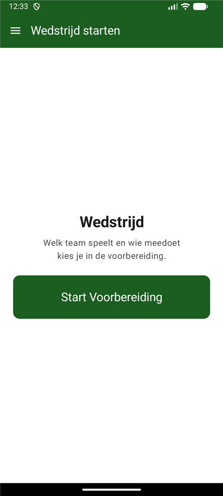
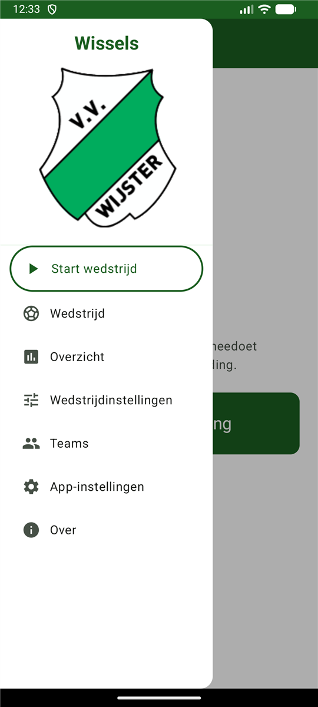
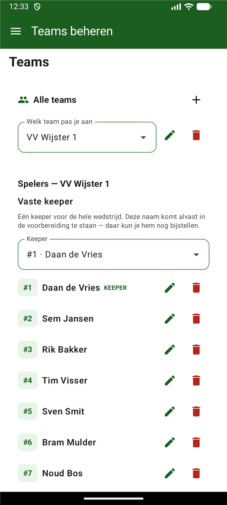
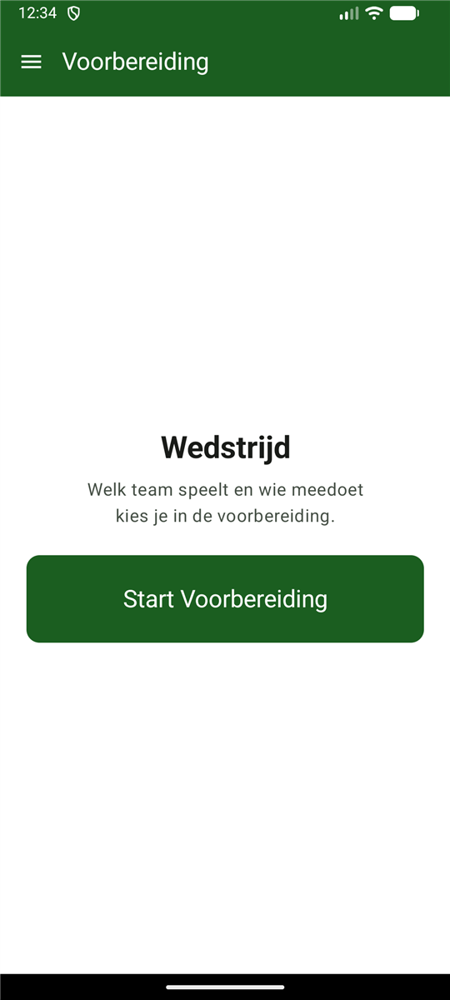
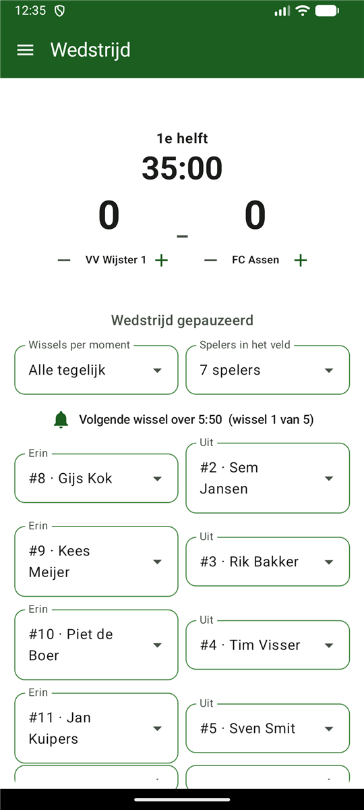
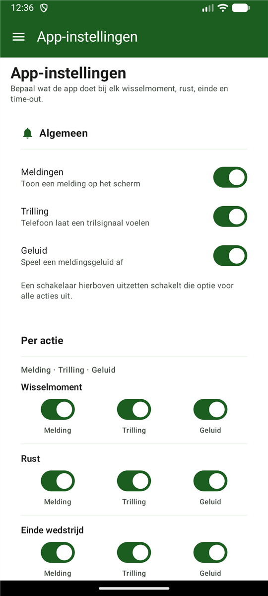

# Wissels ⚽

Een Android-app die **automatisch berekent wanneer en wie er gewisseld moet worden** tijdens een
voetbalwedstrijd, zodat iedereen ongeveer evenveel speeltijd krijgt.

## De APK installeren op je telefoon

1. Download **`Wissels-v0.4.apk`** van de
   [releases-pagina](https://github.com/mistermej/Wissels/releases/latest) en kopieer het bestand
   naar je Android-telefoon (via USB, WhatsApp, e-mail, Google Drive, ...).
2. Open het bestand op de telefoon.
3. Android vraagt: *"Je telefoon installatie van onbekende bronnen niet toestaan"* → tik op
   **Instellingen** en zet **Toestaan van deze bron** aan.
4. Terug en tik op **Installeren**. Klaar.

> De app werkt vanaf Android 8.0 (API 26) en ouder niet — nieuwere telefoons zijn allemaal oké.
> Bij de eerste start geef je meldingen toestaan, anders mis je de seintjes bij een wisselmoment.

## Zo gebruik je de app

### 1. Startscherm
- Eén grote knop in het midden: **Start Voorbereiding**. Verder staat er niets —
  tegenstander, spelers en regels kies je in de volgende stap.

### 2. Voorbereiding
- **Team** kiezen (dropdown) en de **tegenstander** invullen.
- **Deelnemende spelers**: een vinklijst met iedereen uit de selectie — dit is de
  enige plek waar je aanvinkt wie meedoet.
- **Veld en wissels**: aantal spelers in het veld (gekozen waarde uit de
  wedstrijdinstellingen, of — als daar *Vraag in Voorbereiding* staat — hier
  opgeven) en **wissels per moment** (alle tegelijk, of 1 tot zoveel als er op de
  bank zitten — méér kan niet).
- **Keepers**: één keuzelijst als het team een **vaste keeper** heeft (vooraf
  ingevuld, nog te wijzigen), anders twee — één voor de 1e helft en één voor de
  2e helft. **Zonder keeper kun je niet starten.**
- **Wedstrijdinstellingen aanpassen** opent de regels (helftduur, time-out, kaarten, wissels).
- Onderaan: **Wedstrijd starten**.

### 3. Teams (menu)
- Eén keuzelijst om te kiezen welk team je aanpast, met een **potlood** (hernoemen)
  en een **prullenbak** (verwijderen) ernaast; met **+** voeg je een team toe.
- Per team de **namen** van de spelers (met rugnummer als badge), gesorteerd op
  rugnummer (1 bovenaan) — of op naam als er geen nummers zijn. Geen vinkjes:
  meedoen en keepers bepaal je in de voorbereiding.
- **Vaste keeper**: één keuzelijst met een naam voor de hele wedstrijd.

### 4. Wedstrijdinstellingen (menu)
- Alleen een **team kiezen** — aanmaken of hernoemen doe je onder **Teams**.
- **Tijd per helft**, **Aantal spelers in het veld** (optie *Vraag in Voorbereiding*),
  **Time-out** aan/uit (zonder duur), **Kaarten** aan/uit en
  **Wissels automatisch toepassen**.

### 5. Wedstrijd
- Geen actieve wedstrijd? Dan zie je **Geen wedstrijd actief** met een knop om te starten.
- Grote klok en het **scorebord**: per team naam, stand en **− / +** — een doelpunt
  per ongeluk erbij? Met **−** haal je het laatste doelpunt weer weg.
- **"Volgende wissel over 3:24"** met daaronder **wie erin en wie uit gaat**
  ("Klaarzetten voor de wissel"), zodat je de wissels al kunt voorbereiden.
- **Wissels per moment** kun je hier nog bijstellen (geldt voor de rest van de helft).
- Op het wisselmoment trilt de telefoon + melding. Bevestigen doe je met
  **keuzelijst-paren**: links de speler die erin komt, rechts de speler die eruit
  gaat — nog aan te passen, en meerdere wissels tegelijk kunnen.
- De spelers staan in een **raster**: in het veld (max 2×4) en op de wisselbank
  (max 2×3), met speeltijd, keeper-label en kaarten.
- **Start / Pauze** knop, **Start time-out / Einde time-out** (één per helft; daarna
  staat er *Time-out gebruikt*), **Wissel** (handmatig — ook met keuzelijst-paren),
  **Kaart** (geel/rood — rode kaart haalt de speler uit de rotatie, alleen als
  kaarten aanstaan).
- **Rust**: je ziet de **opstelling van de 2e helft**. Controleer de **keeper**
  (keuzelijst) en tik eventueel spelers om te wisselen (één van het veld, één van
  de bank); daarna pas **2e helft starten**.

### 6. Wedstrijdoverzicht
- Zonder wedstrijd krijg je uitleg en een knop om te starten. Daarna: speeltijd per speler
  met balkje, alle kaarten en het volledige wedstrijdverloop.

## Hoe de berekening werkt

- De keeper van de betreffende helft staat altijd in het veld en wordt nooit gewisseld.
- De wisselmomenten staan vooraf vast en liggen **even verdeeld over de helft**
  (max 8 per helft). Hoeveel spelers er per moment **tegelijk** wisselen is instelbaar:
  *alle tegelijk* (de hele bank) of 1 tot 8 spelers — nooit meer dan er op de bank zitten.
- Per moment gaan de spelers met de **meeste speeltijd** eruit en de spelers met de
  **minste speeltijd** erin (bij gelijkheid: wie het langst onafgebroken speelde,
  anders de volgorde in de selectie).
- Zo krijgt iedere veldspeler over de hele wedstrijd nagenoeg evenveel minuten.

Voorbeeld (14 spelers, 11 in het veld, 2×35 min, simulatietest):
keeper 100%, alle veldspelers 75–87,5% (ideaal = 77%).

## Screenshots

| Startscherm | Menu | Teams |
|:---:|:---:|:---:|
|  |  |  |

| Voorbereiding | Wedstrijd | App-instellingen |
|:---:|:---:|:---:|
|  |  |  |

